# Ember — animated new tab for Search


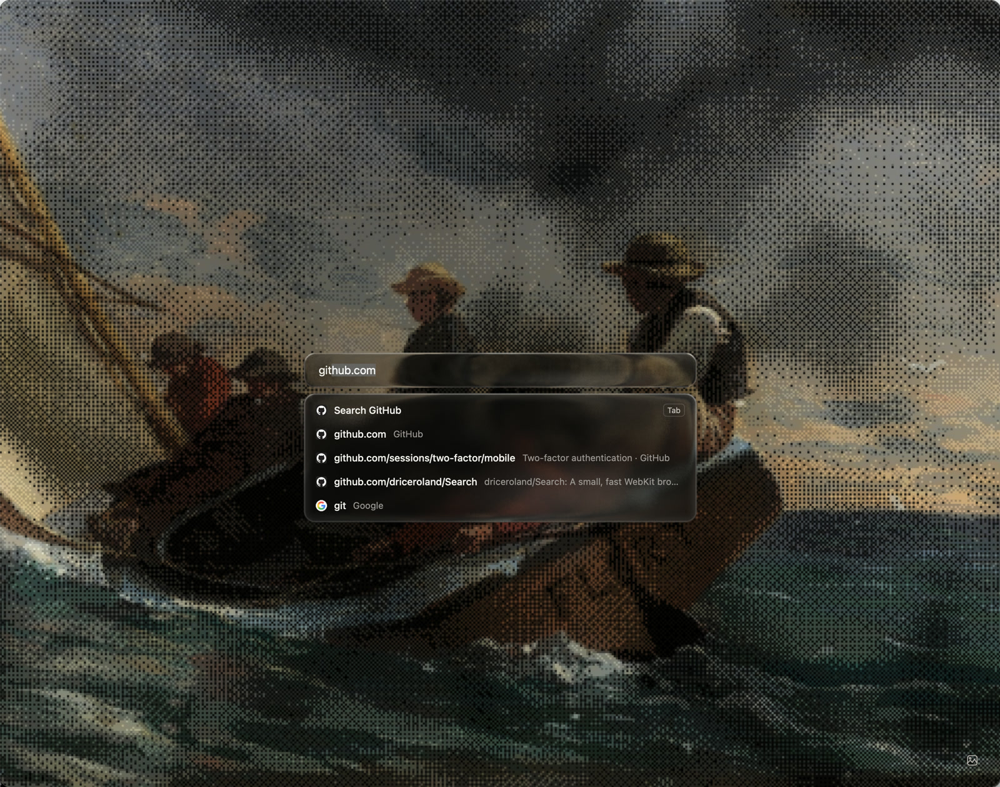


Ember replaces the new tab page of the [Search](https://searchbrowser.app) browser ([source](https://github.com/driceroland/Search)) with a slowly drifting, dithered shader — its own embers, or any image you give it — under an address field that behaves like the browser's own: it finishes addresses as you type, lists history, bookmarks and past searches, searches a site with Tab, and sends words to your default engine.

The field and its rows are liquid glass: lenses drawn by the same shader, refracting the animation behind them. Everything follows the browser's light or dark appearance as it changes.

No dependencies, no build step, no network requests. About 62 KB of source.

## Contents

- [Why it exists](#why-it-exists)
- [Install](#install)
- [Using it](#using-it)
- [The address field](#the-address-field)
- [Backgrounds](#backgrounds)
- [Light and dark](#light-and-dark)
- [Liquid glass](#liquid-glass)
- [Permissions and privacy](#permissions-and-privacy)
- [Performance](#performance)
- [Known differences from Search's own field](#known-differences-from-searchs-own-field)
- [Development](#development)
- [Gallery](#gallery)
- [Credits and licence](#credits-and-licence)

Deeper notes on how it is built: [docs/ARCHITECTURE.md](docs/ARCHITECTURE.md).

## Why it exists

Search's own new tab is a native address field in an empty window. When an extension replaces the new tab page, that field goes away: the page gets no access to it, typing with nothing focused goes nowhere, and Escape does nothing. A new tab extension therefore has two jobs — to draw something, and to put back everything the native field did. Ember does both, and measures itself against the native field's behaviour (see [docs/ARCHITECTURE.md](docs/ARCHITECTURE.md#how-the-native-field-was-matched)).

## Install

Requirements: Search on macOS 15.4 or later (the first version whose WebKit runs extensions).

1. Download or clone this repository.
   ```sh
   git clone https://github.com/fl0wstate/ember-new-tab.git
   ```
2. In Search, open **Settings › Extensions**.
3. Under **Load an unpacked extension**, press **Choose…** and pick the folder that holds `manifest.json`.
4. Approve the permissions (see [what each is for](#permissions-and-privacy)).
5. When Search asks whether Ember may show in new tabs, allow it. You can change this later from the extension's **…** menu: **Show in New Tabs** / **Stop Showing in New Tabs**.

To update, pull the repository and choose **Reload** in the same **…** menu. Reload keeps your saved image. If a new version asks for more permissions, Search shows the list again before loading it.

Ember is written against the standard `chrome.*` extension APIs and should load in Chromium browsers as an unpacked extension, but it has only been run and measured in Search.

## Using it

Open a new tab and type. That is all of it; the rest is detail.

| Key | What it does |
|---|---|
| Any text | Lists matches under the field; a site you visit is finished in the field itself, the finished part selected |
| Return | Goes to the finished address, or to what you typed if it is an address, or searches for it with your default engine |
| ↓ / ↑ | Moves through the rows; the field shows the row's address or search. Past the last row is the field again, as you typed it |
| Tab | When the first row says **Search *Site*** : searches that site instead of the web |
| Backspace | Takes the finished part away; in an empty site search, leaves it |
| Escape | Empties the field (and leaves a site search). In an empty, unused new tab, closes the tab |
| Click a row | Goes there |

The small picture button at the bottom right opens the background menu: **Upload shader image…** and **Reset to orange shader**.

## The address field

### Rows

Under the field, in this order:

1. **Search *Site*** with a `Tab` key cap — when two or more typed letters begin the name or address of a site the field can search (see [site search](#site-search)).
2. Up to three results:
   - **Bookmarks** first (at most two), marked with a bookmark at the right. They need at least two typed letters.
   - **Sites** you have visited, by host, with the title of their front page.
   - **Pages**, shown as address then title.
   - **Past searches** — result pages of a search engine in your history are offered as the words you searched, with a clock, rather than as pages.
3. **What you typed**, to search with your default engine. This row is left out when what you typed is an address.

### What matches

- A single word matches a site when it begins the host or any part of it (`goo` finds `accounts.google.com`), and matches a page when the page's address begins with it.
- Three letters or more also match the beginning of any word in a page's title or path, so `settings` finds `example.com/account/settings`.
- Several words must each begin a word in the title or path.
- When nothing matches a word of four letters or more, sites whose name is one typo away are offered: `githb` finds `github.com`. One typo is a wrong, missing, extra or swapped letter.

### Order

Each visit counts half as much for every 30 days since it happened. A site's weight is the sum over its pages; a page's is its own. Sites and pages are ranked together by that weight, and a match by title or path counts 0.7 of a match by address. Search's own field ranked the same test queries in the same order; see [known differences](#known-differences-from-searchs-own-field) for where it does not.

### Finishing an address

While you type forward, the most-used site whose host begins with what you typed is finished in the field with the added part selected — keep typing to replace it, press Return to go. Once a host is typed in full, its most-used page is finished instead (`localhost:3000` → `localhost:3000/dashboard`). Deleting never finishes anything.

### What counts as an address

- Anything with a scheme (`https://…`, `file://…`).
- A host you have visited before, with the scheme you visited it with.
- `localhost`, names ending `.localhost` or `.local`, IPv4 and IPv6 addresses, with or without a port: opened over `http`.
- A dotted name ending in letters (`example.com`, `docs.example.co.uk/page`): opened over `https`.

Everything else is searched for. An address replaces the new tab in the tab's history, so Back does not return to an empty new tab.

### Site search

Type the start of a site's name, press Tab, type what to find there:

YouTube · GitHub · Reddit · X · ChatGPT · Claude · Perplexity · Wikipedia · Stack Overflow · MDN · Google Maps · IMDb · Spotify · Figma Community

These are the sites built into Search's own field. Sites Search learned from pages you visited, and your own site shortcuts, are kept in the browser's files where an extension cannot read them.

### Searching

Words go through `chrome.search.query`, which is the browser's default engine whichever it is. The engine named on the search row is the one your most recent search in history used; the row carries no name until there is one.

## Backgrounds

**Embers** (the default): layered simplex noise shaped into a plume at the lower right, reduced to seven tones and an 8×8 ordered (Bayer) dither. Each shader pixel covers about three screen pixels, so the dither reads as a weave.

**Your image**: choose **Upload shader image…**. PNG, JPEG, WebP, AVIF, GIF and SVG work, up to 50 MB. The image is cover-fitted to the window, moved gently by the same noise, and its brightness is dithered while its colours are kept. It is stored once as a JPEG no larger than 1280 px on its long side — the shader draws about a third of the window's pixels, so more would only be more to read in every tab — and never leaves the browser. Transparent areas become black.

**Reset to orange shader** removes the stored image.

If WebGL 2 is unavailable, the embers become a still gradient and an image is shown as a plain picture; the field works either way.

With **Reduce motion** on in macOS, one frame is drawn and nothing moves.

## Light and dark

Ember follows the browser's appearance (`prefers-color-scheme`) and changes with it at once, without a reload:

- **Dark**: embers on near-black; an image is woven with black.
- **Light**: the same embers as ink on warm paper; an image is lifted and woven with paper instead of black.
- The field's text, its rows, the menu and the glass tint (smoked by night, milky by day) change with it.

## Liquid glass

The field and the rows are not CSS panes. The shader draws its animation into a small texture, then puts that texture on screen at full size, and wherever the field or the rows lie it reads the texture through a lens: bent at the edges, bevelled at the rim, frosted, tinted, with two slow highlights and a lit edge. Because the lens reads the live animation, the glass moves with it on every frame.

The lens is adapted from [liquidGL](https://liquidgl.naughtyduk.com/). The library itself is not used: it works from a picture of the page, does not see `position: fixed` elements, and cannot follow a live WebGL canvas without recapturing it. Its shader, placed inside Ember's own, can.

Without WebGL the field and rows fall back to an ordinary frosted pane (`backdrop-filter`).

To change the look, edit the constants at the top of `glassSource` in `background.js` (`REFRACTION`, `BEVEL_DEPTH`, `BEVEL_WIDTH`) and the `frost` and `tint` of each pane in `panes`.

## Permissions and privacy

| Permission | What Search's prompt says | What Ember does with it |
|---|---|---|
| `history` | Read and change your history | Reads it once per new tab to offer sites, pages and past searches. Never changes it. |
| `bookmarks` | Read and change your bookmarks | Reads them once per new tab to offer bookmarks. Never changes them. |
| `tabs` | See your open tabs and their addresses | Reads the icons of open tabs to put beside matching rows; closes its own tab on Escape. |
| `search` | (no prompt) | Sends what you search to the browser's default engine. |

- Nothing is sent anywhere. The page's content security policy is `connect-src 'none'`: it cannot make a network request at all. The only navigation is the one you ask for with Return.
- History, bookmarks and tab icons are held in memory while the new tab is open and are gone when it closes.
- Stored on disk: your background image (one JPEG, in the extension's IndexedDB) and one `localStorage` key recording whether an image is set.
- No content scripts, no background worker: Ember runs only inside the new tab page and does nothing in other tabs.
- No host permissions: it cannot read or change any website.

## Performance

Measured in Search 1.0.14 on an Apple M2, 2880×1864 display, window 1427×1124 pt, with an image set and a history of about 2,000 entries. CPU is percent of one core. Method and caveats: [docs/ARCHITECTURE.md](docs/ARCHITECTURE.md#measurements).

| Opening a new tab (median of 6) | |
|---|---|
| Scripts run, field takes keys | 12 ms |
| First contentful paint | 16 ms |
| First shader frame, image and glass included | 68 ms (50–97) |
| History read (about 2,000 entries), once, after first paint | 39 ms |
| One key: match and redraw rows | 1–3 ms |

| While the tab is visible | A static page | Ember |
|---|---|---|
| GPU utilisation, whole system | 0–2% | about 10% |
| Browser GPU process | 1.4% | about 5% |
| Browser main process | about 1% | about 4% |
| Page process | 0% | 5.4–6.7% |
| GPU process memory | — | +15 MB |

A hidden new tab draws nothing: the page reports itself hidden, the timer stops, and its process sits at 0.0% CPU.

What keeps it at that: the animation runs at 20 frames a second into a texture a third of the window's size; the glass pass costs one texture read per pixel outside the lenses and sixteen inside; the canvas is one pixel per CSS pixel rather than Retina's four; nothing is compiled or decoded before the first paint.

## Known differences from Search's own field

- The selected tab's row in the sidebar reads "Extension page" when Search is set to show the site of the tab you're on. That label is the browser's for any extension address.
- Site shortcuts the browser learned or you defined are not offered; only its fourteen built-in sites.
- Suggestions from the search engine as you type, commands in the address field, and Shift-Return for a second engine are not built.
- Icons come from tabs you have open (or the same site's parent domain). Other rows wear a letter.
- Pages within one site can come in a different order than the native field's.
- Opening is slower than the native new tab's roughly 10 ms: it is a web page, and Search adds its own 212 KB compatibility script to every extension page.

## Development

```
manifest.json    permissions, new tab override, content security policy
newtab.html      the page: canvas, field, rows, background menu
background.css   layout, both appearances, the no-WebGL fallback panes
search.js        the address field
background.js    the shader, the glass pass, light and dark
wallpaper.js     choosing, storing and loading the image
test/            end-to-end test (Playwright, Chrome)
tools/           screenshot generator
docs/            architecture notes and screenshots
```

There is no build. Edit a file, then **Reload** the extension in Search's settings.

```sh
npm install        # Playwright only, for the test and screenshots
npm test           # needs Google Chrome installed
npm run screenshots
```

The test serves the page under the manifest's own content security policy and covers the shader (image colours, cover crop, texture cap, animation, reduced motion, hidden-tab pause), storage (persistence, reset, a broken file), the glass (the lens sits exactly on the field), light and dark, the no-WebGL fallback, and the field against a stand-in for the browser's APIs: completion, rows, arrows, Tab, Escape, typo matching, bookmarks, addresses and default-engine search.

When changing the version, change it in `manifest.json` and in the `?v=` of the four files `newtab.html` loads, so no cached copy of an older script can be reused.

## Gallery

| | Dark | Light |
|---|---|---|
| New tab | 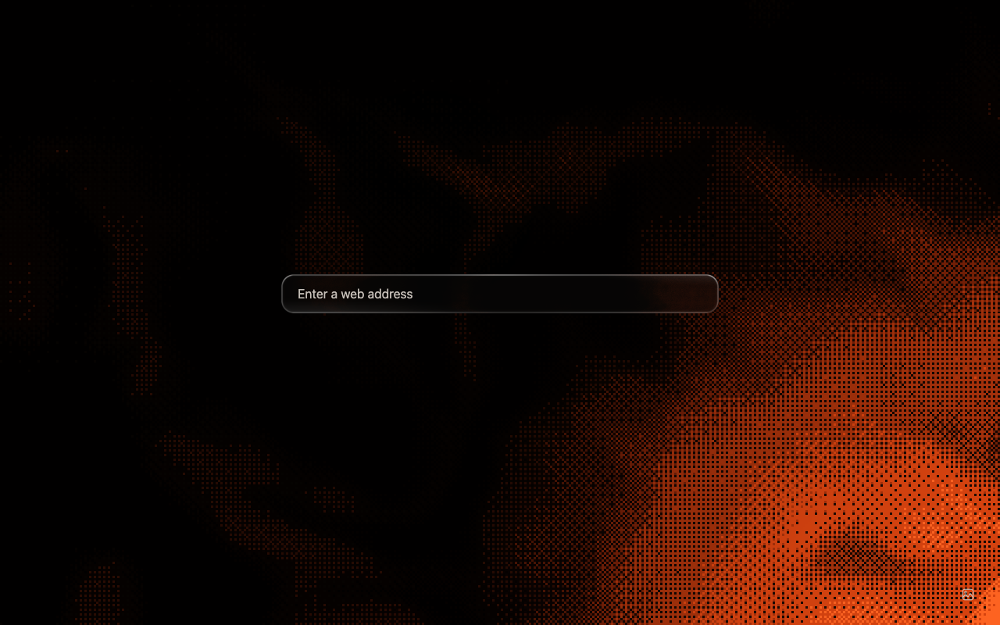 | 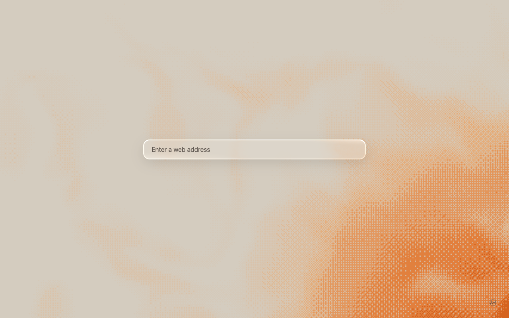 |
| Rows while typing `gi` | 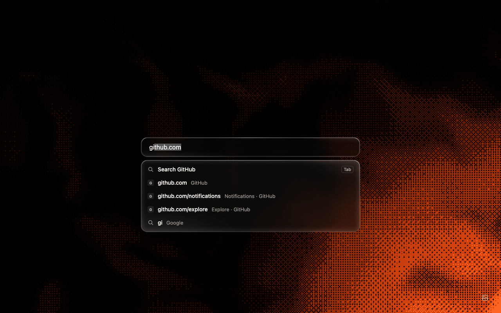 | 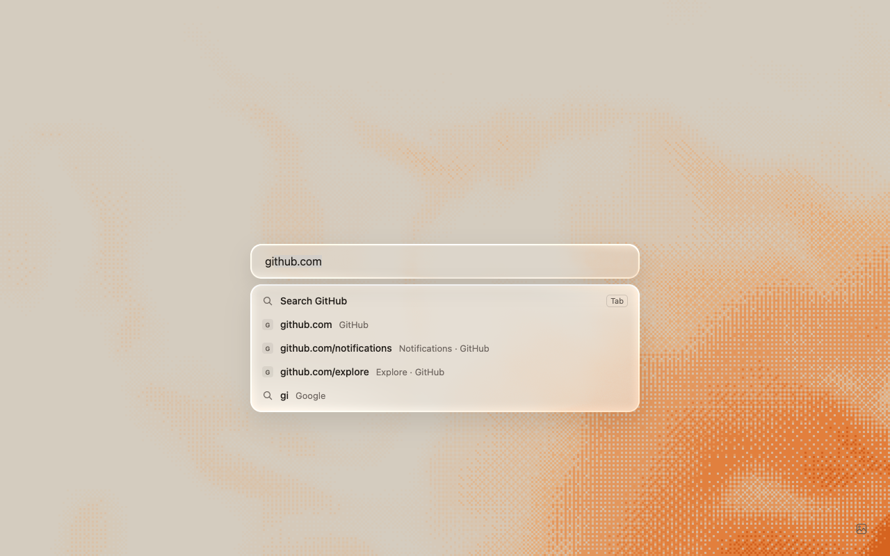 |
| A past search, picked with ↓ | 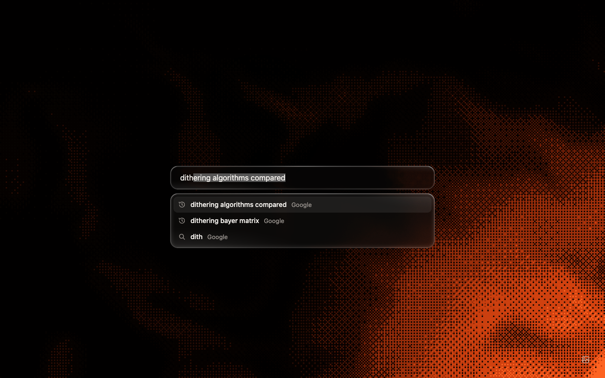 | 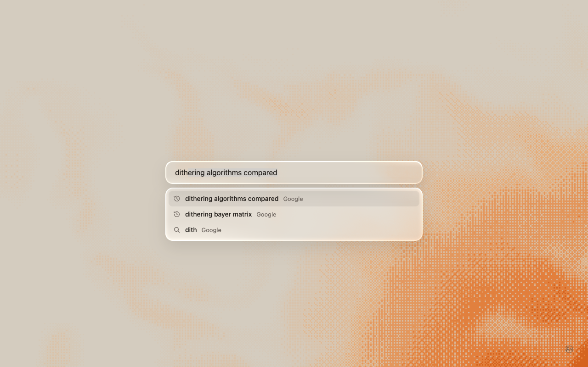 |
| Site search after `yo` then Tab | 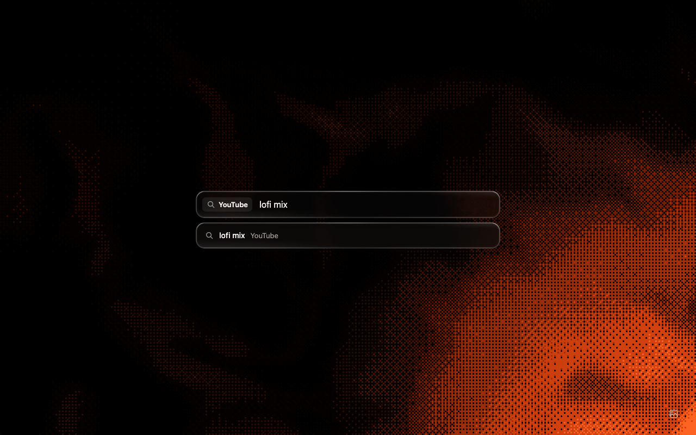 | 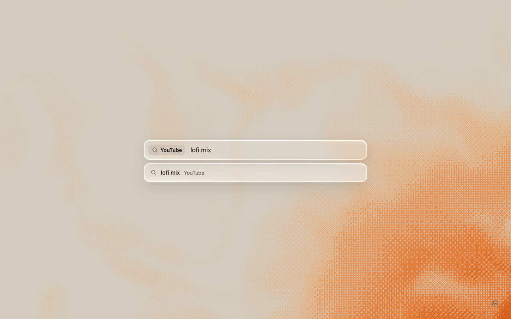 |
| Your own image | 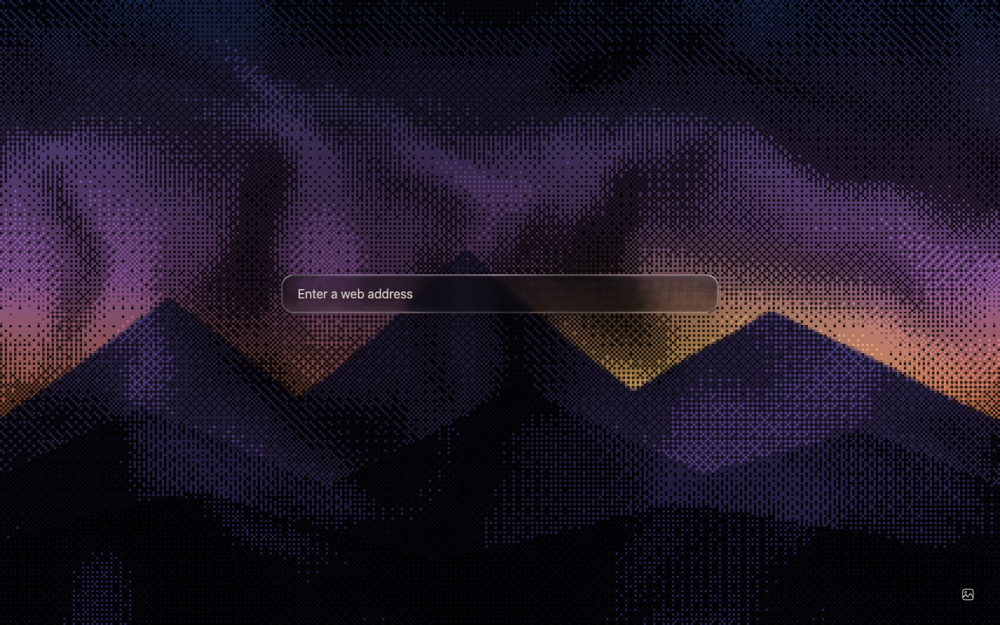 | 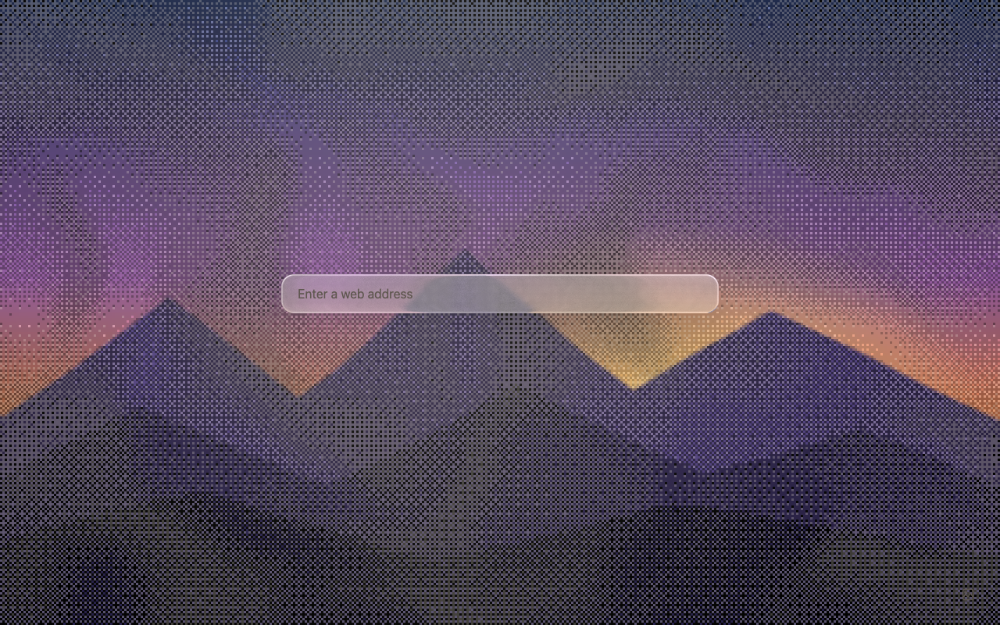 |
| Rows over an image | 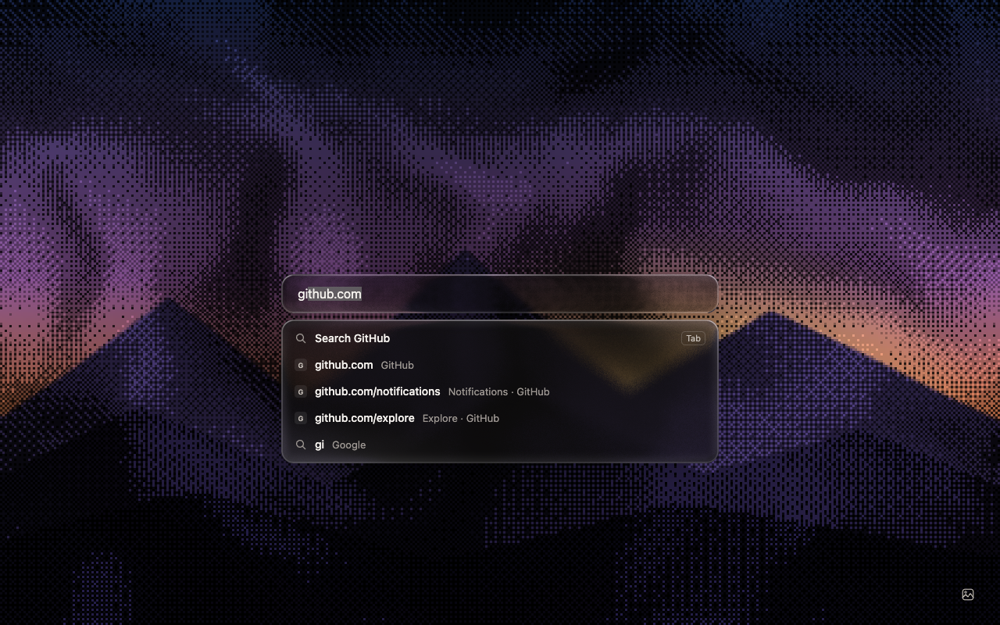 | 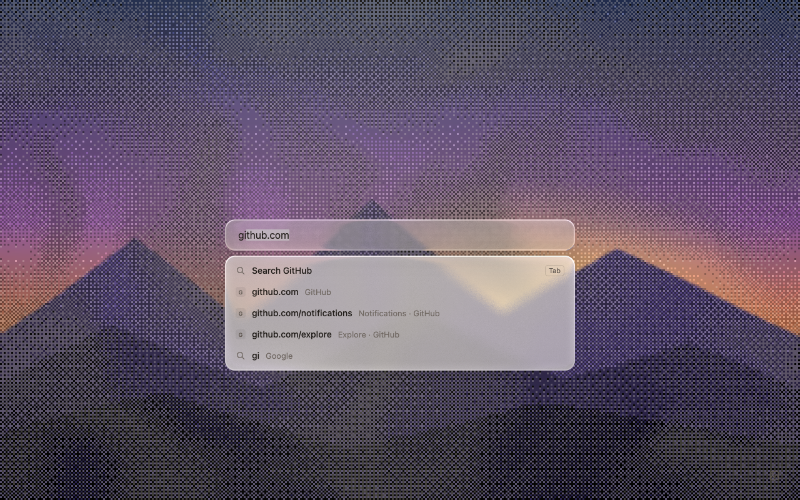 |
| Background menu | 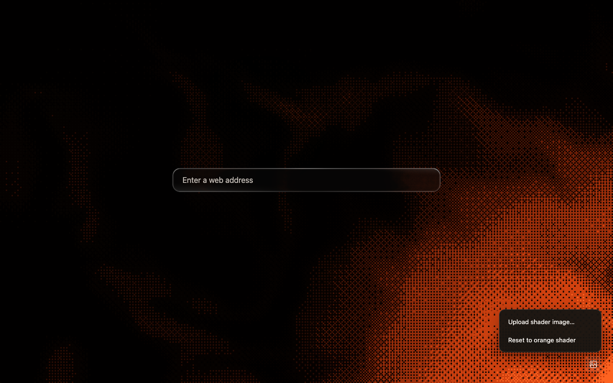 | 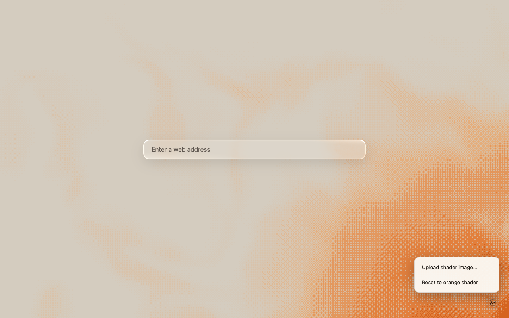 |

## Credits and licence

MIT — see [LICENSE](LICENSE).

The glass lens is adapted from [liquidGL](https://liquidgl.naughtyduk.com/) by NaughtyDuk, MIT; see [NOTICE.md](NOTICE.md). The noise and dither shader is written for this project.

Ember is an independent extension for Search and is not affiliated with Office Commun.
